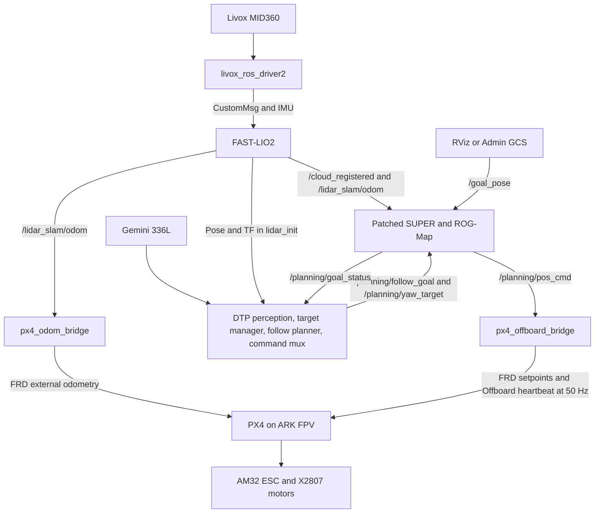

# Implementation Guide — SUPER for Vision-Based Human Following
### Jetson Orin NX 16 GB · Livox MID360 · Gemini 336L · ARK FPV (PX4 v1.17.0) · ROS 2 Humble

This document is the step-by-step plan for running **SUPER** (HKU-MaRS safety-assured LiDAR
MAV planner) as the **local obstacle-avoiding planner** for a drone that **follows a human
through a forest**. Your vision module supplies the human's position; SUPER plans a safe,
collision-free trajectory to a point behind the person and a controller flies it through PX4.

This is precisely the paper's **object-tracking application** (`scirobotics.ado6187.pdf`,
Fig. 2A / Fig. 4): *"we commanded SUPER to track an object by repeatedly assigning its local
planning goal as a position behind the object."*

---

## 0. Progress Tracker & Checklist

> **Status — 2026-09-12: M4's open checklist and M5 below are superseded by
> [`m5-m6-plan.md`](m5-m6-plan.md).** It re-cuts the milestones:
> - **Gate 0** — safe to fly autonomously;
> - **M5** — the DTP follower flies;
> - **M6** — the paper's loss-cause classifier, which is not implemented.
>
> It carries dated rows, numeric pass thresholds and sample sizes. Gate 0 as of 2026-09-13:
> - **XRCE hardfault:** reproduced; the RX-DMA fix failed; a client-side fix is flashed and passed
>   30/30 reconnects, soak pending.
> - **G0.2 closed:** a 3.74 km FAST-LIO error caused by a second Livox driver, now refused at
>   three layers.
> - **G0.4 done:** `setup.sh` applies the regenerated SUPER patch.
> - **Still open:** `max_vel: 5.0` in `follow_test_ros2.yaml`.
>
> **Status — 2026-09-14: M6 is BUILT and bench-gated; M5's desk items are done; nothing has
> flown.** The loss oracle (SUPER patch 0004, `dtp_msgs/LossEvent`), the reappearance belief,
> loss conditioning behind one `loss_conditioning` switch, the stock baseline, the replay and
> labelling harness, and the M6.6 offline predictor study all exist — see the M6 section below,
> [`m6-loss-oracle.md`](m6-loss-oracle.md) and [`m6.6-predictor-study.md`](m6.6-predictor-study.md).
> Every software gate is green on that build; the full graph came up observe-only on the bench
> with both preflights GO (`drone-dtp/scripts/bench_bringup.sh`); the G0.1 session-loss cycle
> count is being pushed toward 500. Still needing the aircraft: M5.1 trials, M5.4 outdoor depth
> and motor-on calibration, M5.5 onwards, M6.3, M6.7, `robot_r`, the yaw mount check, the 14 h
> soak.
>
> The checklists below are kept as the record of what was open on 2026-09-10.
>
> **Status — 2026-09-10:** M0/M1 signed off (stationary resource regression resolved);
> M2 hand-motion and M3 props-off gates signed off 2026-09-02. M3's historical
> hardware result was 7/7; the current gate has nine checks. M4 is implemented
> in `drone-dtp/` on branch `dtp-follower-stack` (since 2026-09-12, symlinked into
> `~/super_ws/src/drone-dtp`; see `drone-dtp/README.md`); integration and
> M5 field validation remain open. Read [the DTP source inspection](dtp-follower-stack.md).
>
> P3 on 2026-09-02 did not pass (no takeoff, nine position resets); P5 on
> 2026-09-04 is void (flow hover with the LiDAR stack stopped). Neither proves
> LiDAR-controlled flight. These records supersede earlier "nothing has flown"
> claims; see [the flight plan](flight-test-plan.md). Archived FC hardfaults
> remain unfixed flight blockers.
>
> The reproducible M1–M3 setup lives in the repo **`super-human-follow`**
> (github.com/kleverin/super-human-follow, private): `scripts/setup.sh` (build all deps + patches),
> `scripts/network_setup.sh` (MID360 static IP, now auto-detects the wired iface),
> `scripts/run.sh` (bring-up), `scripts/laptop_viewer.sh` (remote RViz),
> `scripts/px4/` (**new** — FC tooling over MAVLink UDP), and `docs/`.
> `setup.sh` does **not** install DTP or apply its SUPER follow-goal patch. It
> does enable raycasting (and `p_max: 0.95`) in the click config.
>
> ✅ **Flight controller confirmed: ARK FPV running PX4 v1.17.0 + uXRCE-DDS.**
> Confirmed live over MAVLink: `MAV_AUTOPILOT_PX4`, `MAV_TYPE_QUADROTOR`, firmware `v1.17.0`,
> sysid 1, `SYS_AUTOSTART=4001`. ArduCopter equivalents (`SERIALx_PROTOCOL`) are absent.
>
> ✅ **M2 transport RESOLVED (2026-07-27).** `uxrce_dds_client status` → `Running, connected`,
> 33 kB/s tx, `timesync converged: true`; all `/fmu/*` topics up. The blocker was never the
> wiring — **`UXRCE_DDS_CFG` was `0`**, so the XRCE client had never started. Full post-mortem
> in [`uart_bringup_log.md`](uart_bringup_log.md).
>
> ✅ **M2 odometry path COMPLETE (2026-07-29).** `px4_odom_bridge` written and verified on
> hardware; real MID360→FAST-LIO odometry reaches the FC (`Payload rx: 1157 B/s`), EKF2 accepted
> it (`xy_valid: True`, `z_valid: True`, `ekf2 status → local position: 1`) on the `vision-only`
> profile with GPS disabled.
>
> ✅ **M2 GATE SIGNED OFF (2026-09-02, on the Orin NX).** Re-run end-to-end after the FAST-LIO
> latency fix. `ekf2 status → attitude: 1, local position: 1`; `cs_ev_pos`/`cs_ev_yaw`/`cs_ev_hgt`
> all `True` with zero innovation rejections; `Payload rx: 1154-1158 B/s`. **Hand-motion tracking
> verified** over a 120 s test with ~1 m excursions on all three axes: correlation between PX4's
> `vehicle_local_position` and `/lidar_slam/odom` was **+0.9935 / +0.9985 / +0.9997 (N/E/D), all
> signs correct**, max tracking error 10.4 cm (inside the 0.1 m std the bridge declares),
> **0/1195 samples** with `xy_valid`/`z_valid` false, `dead_reckoning` never set, and **no EKF
> resets** during the moves. 15-min soak — well past the ~8 min where the old gate collapsed —
> held FAST-LIO RSS flat at 155.9 → 155.8 MB with 0 B swap and `rejected=0` on 14 494 bridge
> messages. Details in §M2. The two open questions are closed:
> [`fact-ev-delay.md`](fact-ev-delay.md) and [`fact-ev-frd-yaw-align.md`](fact-ev-frd-yaw-align.md).
> ✅ **M1's FAST-LIO RAM/CPU regression is RESOLVED for the stationary case (2026-08-26)** — root
> cause was `/Laser_map` (zero subscribers) accumulating forever; fixed by `map_en: false`.
> 18-min endurance re-run held flat RAM and 10 Hz odom. See §M1 regression and §5. Moving-rig
> endurance is still untested before flight.
>
> 🟡 **M3 controller bridge WRITTEN AND VERIFIED (2026-09-02).** The missing `px4_bridge.py` was
> **rewritten from scratch** rather than recovered — as `super_bringup/scripts/px4_offboard_bridge.py`,
> named to pair with `px4_odom_bridge.py`. Verified on hardware, in three layers:
> 1. **Bench gate 16/16** — `scripts/px4/m3_bridge_check.py` runs the real node in a sandbox
>    (every topic remapped under `/m3_check/`, synthetic PX4 state) and asserts the frame
>    conversion, the yaw sign *and that it is not the `π/2−ψ` trap*, yaw wrapping, the >2 Hz
>    heartbeat, NaN rejection, and both stale-setpoint behaviours. No FC involved; safe any time.
> 2. **End-to-end into PX4** — the FC's own uORB confirms receipt:
>    `listener offboard_control_mode` → `position: True`, 25 ms old;
>    `listener trajectory_setpoint` → live NED values, 19 ms old;
>    `Payload rx` rose **1154 → 5140 B/s**. `offboard_control_signal_lost: False`.
> 3. **Against the real planner** — with a `/goal_pose` set, 910 of 913 emitted setpoints were
>    *exactly* a real SUPER command under `(x,−y,−z)` / `ψ→−ψ`, worst residual **1.18e-07**
>    (float32 precision). The 3 misses are capture-window boundary effects. Command travel over
>    the window: x [+0.02, +3.02] m, z [−0.15, +1.52] m.
>
> **Offboard mode engages on this aircraft** (`offboard -> ACCEPTED`, `nav_state = OFFBOARD`),
> which corrects a long-standing claim in these docs that RC was required for it — see
> [`fact-offboard-rc-arming.md`](fact-offboard-rc-arming.md).
>
> ✅ **M3 GATE SIGNED OFF 2026-09-02, props off, 7/7** (`scripts/px4/m3_gate_check.py`, recorded
> over 210 s / 10 293 samples while the pilot drove the whole sequence from the RC):
> **armed in Offboard** across three separate engagements, **34 s** total;
> **setpoint frozen — max drift 0.013 m** while armed (the position-hold criterion: SUPER idle,
> bridge in HOLD, commanded point must not wander);
> **manual takeover observed twice** (t=52.9 s and t=91.4 s, Offboard → Stabilized, ±0.5 s);
> **0 invalid position samples, never dead-reckoning, no EKF resets.**
> An RC receiver was bound between the two runs, which cleared `remote_control` from
> `arming_check_error_flags`. The first attempt **failed usefully**: the sequence cycled
> Stabilized/Position/Altitude and never reached Offboard, because there was no Offboard slot on
> the mode switch. Fixed with **`RC_MAP_OFFB_SW = 11`** — a dedicated two-position Offboard switch,
> which gives RC engage *and* RC takeover on one channel.

### M0 — Build SUPER (ROS 2) on the Jetson — ✅ DONE
- [x] `select_ros_version.sh ROS2`; apt deps; Eigen symlink
- [x] `colcon build` green (fixes: `isnan`→`std::isnan` ×19, `find_package(pcl_conversions)`, `COLCON_IGNORE` on root duplicate trees)
- [x] Jetson max performance (`sudo nvpmodel -m 0` + `sudo jetson_clocks`)
- [x] Benchmark sim runs headless (`benchmark_high_speed.launch.py`) — stack holds real-time
- [ ] Formal replan-compute-time baseline recorded to a log (runs real-time; not separately captured)

### M1 — Sensing & state estimation (FAST-LIO2 + MID360) — ✅ DONE, ⛔ 1 OPEN REGRESSION
**Livox driver**
- [x] Livox-SDK2 + `livox_ros_driver2` built; `xfer_format=1` (CustomMsg, needed by FAST-LIO)
- [x] MID360 network: **persistent NetworkManager profile** (192.168.1.50/24, LiDAR @ 192.168.1.154) — survives reboot, not flushed
      ⚠️ **The wired iface name is not stable across boards.** It was `enP8p1s0` on one unit and is
      **`eno1`** on the Orin Nano Engineering Reference devkit. `network_setup.sh` now auto-detects
      it (prefers an iface with a live carrier; override with `IFACE=`).
- [x] `/livox/lidar` ~10 Hz, `/livox/imu` ~200 Hz
**FAST-LIO2**
- [x] `hku-mars/FAST_LIO` (ROS2 branch) + ikd-Tree submodule cloned
- [x] **Build fix: CMake `-std=c++14` → `c++17`** (Humble rclcpp 16.x is C++17-only)
- [x] `mid360.yaml`: MID360 LiDAR↔IMU extrinsics; retuned 2026-07-29 (see regression below)

#### ⛔ OPEN REGRESSION (found 2026-07-29): FAST-LIO unbounded RAM + CPU saturation

**This is a flight-safety issue, not a benchmarking annoyance** — EKF2 now runs `vision-only`
with no GPS, so when FAST-LIO degrades PX4 loses its *only* position source. Observed live:
`ekf2 status` went `local position: 1` → `0`.

| Observation | Value |
|---|---|
| FAST-LIO RSS, original config | **2.97 GB after 18 min**, growing ~1.7 MB/s, linear, no plateau |
| CPU | pegged at **100%** of one core |
| Result | Jetson (7.4 GB) swap-thrashed; `/lidar_slam/odom` fell **10 Hz → 0.55 Hz** |
| Meanwhile `/livox/lidar` | a healthy **9.9 Hz** — so the LiDAR/driver were fine |

**Root cause:** the ikd-Tree map is only trimmed by `lasermap_fov_segment()`, which deletes
regions as the vehicle approaches the `cube_side_length` boundary. **A stationary bench rig
never triggers trimming**, so the map grows forever. A follow-drone working a small forest
area may not trigger it either.

**Ruled out — do not re-investigate:**
- `pcd_save_en` — the `pcl_wait_save` accumulation block in `laserMapping.cpp` (~L520-543) is
  inside a `/* */` comment and never executes. Disabling it changed nothing.
- **Odometry drift** smearing the map — position stayed within ~10 cm over 6 min while stationary.
- **Duplicate publishers** — there *was* a window with two Livox drivers (orphans from repeated
  restarts; `/livox/lidar` Publisher count: 2), which inflated one measurement. Growth continued
  at the same rate after cleanup.

**Mitigation applied** (repo `config/mid360.yaml`; `setup.sh` installs it):

| Param | Was | Now | Effect |
|---|---|---|---|
| `point_filter_num` | 1 | **3** | the big one: CPU 100% → 64%, growth 1.7 → ~0.55 MB/s. Upstream MID360 default. |
| `cube_side_length` | 1000.0 | 200.0 | smaller ikd-Tree extent; only helps once moving |
| `det_range` | 100.0 | 70.0 | matches MID360 spec (~70 m @ 80% reflectivity) |
| `pcd_save_en` | true | false | no effect (dead code) but correct anyway |

**~0.55 MB/s survived all four of the above — because none of them were the actual leak.**

#### ✅ RESOLVED (2026-08-26): the residual leak was `/Laser_map`, a topic nothing subscribes to

Root-caused directly in `laserMapping.cpp` (this Jetson has the FAST-LIO source tree, so this
was read, not guessed): `map_publish_callback()` fires off a **1000 ms wall timer, for the life
of the process**, and unconditionally does `*pcl_wait_pub += *laserCloudWorld;` in `publish_map()`.
`pcl_wait_pub` is a file-scope `PointCloudXYZI::Ptr` that **is never cleared anywhere in the
file** — every second it gets bigger, forever, independent of the ikd-Tree, `point_filter_num`,
or `cube_side_length` tuning above. It's gated by `publish.map_en` (our `mid360.yaml` had this
`true`, publishing `/Laser_map`), and `ros2 topic info /Laser_map` showed **`Subscription
count: 0`** — SUPER's ROG-Map ingests `/cloud_registered` + `/lidar_slam/odom`, never `/Laser_map`.
The entire topic, and the RAM behind it, was dead weight.

**Fix:** `publish.map_en: true → false` in `config/mid360.yaml`.

**Verified live on hardware, same 18-minute window as the original crisis measurement:**

| | Before fix (this session, `map_en:true`) | After fix (`map_en:false`) |
|---|---|---|
| RSS @ t=60s | +37 MB already (0.62 MB/s) | +8.5 MB, decaying |
| RSS @ t=18 min | (would extrapolate to ~+600 MB on top of the 2.97 GB baseline) | **157,704 KB → 154,168 KB (net −3.5 MB — flat, within noise)** |
| `/lidar_slam/odom` rate | — | held **10 Hz** the entire 18 min (no degradation) |

RSS actually drifted slightly *below* its starting value at several checkpoints (glibc handing
pages back after the ikd-Tree's own steady-state settles), confirming there's no more unbounded
growth. **This closes the M1 regression** — combined with the `point_filter_num`/`cube_side_length`
mitigation above, FAST-LIO now holds flat RAM and CPU on a stationary bench rig, the case that
previously never triggered ikd-Tree trimming at all.

Next before flight: re-run this endurance test **while moving the rig** (not just stationary),
since `cube_side_length`'s trimming behavior only engages with motion and was never isolated from
this fix.

> Note this partly invalidates the earlier "M1 DONE, verified on hardware" claim: the gates were
> real but short. Long-duration behaviour is now tested (stationary case); moving-case endurance
> is still open.

**Integration (`super_bringup`)**
- [x] `m1_super_lidar.launch.py` — FAST-LIO + identity `world→lidar_init` TF + `fsm_node`, **no `perfect_drone_sim`** *(frames renamed from upstream `camera_init`/`body` on 2026-09-02 — see `patches/fastlio_frames.py`)*
- [x] odom remap `/Odometry` → `/lidar_slam/odom`; `/cloud_registered` already world-frame (matches ROG-Map)
- [x] `virtual_ground_height: -1.0` (so ground-level/handheld odom z≈0 isn't rejected)
**Gates (all verified live — but see the regression above: these were all SHORT runs)**
- [x] **Gate A** — driver rates OK
- [x] **Gate B** — `/cloud_registered` **world-stable while moving the rig** (confirmed in RViz: walls stay locked, odom frame tracks); `/lidar_slam/odom` non-divergent, pose ≈ origin
- [x] **Gate C** — ROG-Map populates from the live cloud (`rog_map/occ`≈6073, `rog_map/inf_occ`≈12–15k voxels); no odom-timeout / below-ground warnings; FSM idles in `INIT` until first `/goal_pose` (expected)
- [x] Remote RViz from a laptop over DDS (same Wi-Fi, `ROS_DOMAIN_ID=0`)
- [ ] (known issue) MID360 point-stream can **stall** (IMU keeps running) → odom diverges; fix = restart Livox driver. Add a watchdog in M5.

### M2 — FC link + external odometry — ✅ DONE (gate signed off 2026-09-02)

> ⚠️ **Second UART fault, found and fixed on the Orin NX 2026-08-31.** After the board swap the
> transport broke again and looked identical to a dead wire. It was **neither** the wire **nor**
> the FC: Tegra HSUART **DMA** on `serial@3100000` delivered **zero-filled buffers** to the tty
> layer — correct byte count, zero framing errors, payload replaced by `0x00`. Proof with no FC
> attached: TX jumpered to its own RX, writes of ≤4 bytes echoed exactly, ≥8 bytes came back all
> zeros, at 115200/921600/3000000 alike. **Fix:** remove `dmas`/`dma-names` from that DT node to
> force PIO (boot-time `FDT` override). The link came up on the first try afterwards:
> `Running, connected`, `Payload tx 35910 B/s`, 65 `/fmu/*` topics, odom ~100 Hz.
> **The DTB override does not survive a JetPack upgrade** — run
> `bash scripts/uart_loopback_test.sh` after any system update. Full write-up:
> `docs/xrce-agent-nx.md`.

**Transport: ✅ DONE (2026-07-27 on the Nano; re-established on the NX 2026-08-31).** uXRCE-DDS is
connected and streaming.
- Root cause of the *first* long "UART fault" was **`UXRCE_DDS_CFG = 0`** — the XRCE client was
  never started on the FC. The wiring was fine then too. See `docs/uart_bringup_log.md`.
- Applied on the FC: `UXRCE_DDS_CFG=101` (TELEM1 = UART7 = `/dev/ttyS6`, per ARK's pinout docs),
  `SER_TEL1_BAUD=3000000`, `MAV_0_CONFIG=0` (frees TELEM1; MAVLink still runs on USB).
- Agent is ARK OS's own `dds-agent.service` (`MicroXRCEAgent serial -b 3000000 -D /dev/ttyTHS1`) —
  **already running, do not start a second one.**
- Wiring: FC TELEM1 pin2 TX → Jetson 40-pin **pin 10**; pin3 RX → **pin 8**; pin6 GND → **pin 6**.
  Leave pin 1 (5V) and pins 4/5 (CTS/RTS) unconnected.
- Verified: `uxrce_dds_client status` → `Running, connected`, tx 33 kB/s, `timesync converged: true`.
  3 Mbaud is stable over jumpers — no need to drop to 921600.

**Remaining for M2:**
- [x] `px4_msgs` at `release/1.17` cloned into `~/super_ws/src` (was absent entirely, not "on 1.14").
- [x] `/fmu/out/*` and `/fmu/in/*` topics present; `/fmu/in/vehicle_visual_odometry` shows
      `Subscription count: 1` — the FC is already waiting for our odometry.
- [x] Built **`px4_odom_bridge`** (`super_bringup/scripts/px4_odom_bridge.py`):
      `/lidar_slam/odom` → `/fmu/in/vehicle_visual_odometry`, FLU→FRD, timestamp handling.
      **Verified end-to-end on hardware** with `scripts/px4/fake_odom_pub.py`:
      `uxrce_dds_client` showed `Payload rx: 3453 B/s`, and PX4's
      `listener vehicle_visual_odometry` decoded `position: [-0.797, -0.605, -0.500]`
      (sent z=+0.5 up → received z=−0.5 down ✅), `pose_frame: 2` (FRD),
      `velocity: [nan,nan,nan]`, timestamp_sample 1.8 ms before timestamp.
      - Publishes **`POSE_FRAME_FRD`, not NED** — FAST-LIO's world frame is z-up with an
        arbitrary constant heading offset, which is PX4's definition of FRD. Declaring NED
        would assert North-alignment and make EKF2 fight the magnetometer.
      - **Velocity off by default.** `nav_msgs/Odometry` puts `twist` in `child_frame_id`, but
        FAST-LIO forks disagree (several publish world-frame). Wrong-frame velocity is worse
        than none. Enable `publish_velocity:=true` only after verifying on hardware.
      - Rejects non-finite odometry, so a MID360 stall (§M1 known issue) can't push NaN into EKF2.
- [x] **Verified with real LiDAR odometry (2026-07-29).** Full chain live:
      `MID360 → livox driver (10 Hz / IMU 200 Hz) → FAST-LIO2 → /lidar_slam/odom →
      px4_odom_bridge → /fmu/in/vehicle_visual_odometry → XRCE → PX4`, at
      **`Payload rx: 1157 B/s`** (≈10 Hz × 115 B). Bridge counters `in=2519 out=2519 rejected=0`.
      PX4 `listener vehicle_visual_odometry` showed a stationary rig at
      `position: [0.006, 0.017, 0.043]`, roll/pitch/yaw ≈ 0°, `pose_frame: 2`.
- [x] **EKF2 external-vision params applied (2026-07-29)** via the new profile switch:
      `EKF2_EV_CTRL=11`, `EKF2_HGT_REF=3` (Vision), `EKF2_GPS_CTRL=0`.
      **`11`, not `15`** — bit 4 is velocity, and the bridge deliberately does not publish it.
      Applied only *after* confirming the bridge was streaming; doing it earlier would leave
      EKF2 with no valid aiding source at all.
- [x] **EKF2 accepted the vision source.** After `ekf2 stop` / `ekf2 start`:
      `ekf2 status → attitude: 1, local position: 1, global position: 0`, and
      `vehicle_local_position` reported `xy_valid: True  z_valid: True  v_xy_valid: True
      v_z_valid: True`, `heading_var: 0.0007`. **This is PX4 holding position from the MID360
      alone, GPS off.**
- [x] ✅ **GATE SIGNED OFF (2026-09-02, Orin NX).** Re-run clean after the FAST-LIO latency fix.
      - `ekf2 status → attitude: 1, local position: 1, global position: 0`;
        `xy_valid/z_valid/v_xy_valid/v_z_valid` all True, `dead_reckoning: False`.
      - `estimator_status_flags`: `cs_ev_pos`, `cs_ev_yaw`, `cs_ev_hgt` all `True`,
        `cs_gnss_pos: False`, **every `reject_*` and `fs_*` flag False**.
      - **Hand-motion tracking — the gate step that had never been run.** 120 s, ~1 m excursions
        on all three axes, comparing `/fmu/out/vehicle_local_position_v1` against
        `/lidar_slam/odom` at 10 Hz (1195 samples):

        | axis | correlation | sign | max err moving | max err still |
        |---|---|---|---|---|
        | N | +0.9935 | correct | 0.053 m | 0.072 m |
        | E | +0.9985 | correct | 0.104 m | 0.052 m |
        | D | +0.9997 | correct | 0.047 m | 0.028 m |

        Excursions 0.96 / 0.88 / 1.12 m. **0/1195** samples invalid, `dead_reckoning` never set,
        `xy_reset_counter` 4 → 4 (no resets during the moves), `eph` max 0.064, `epv` max 0.040.
        **All three signs correct rules out an inverted axis or an axis swap** — the failure that
        is invisible on a stationary bench and would flip a control loop in M3.
      - **The lever arm is independently confirmed.** The constant PX4−FAST-LIO offset measured
        `(−0.014, +0.024, +0.064) m`, i.e. the negative of `EKF2_EV_POS = (+0.011, −0.023, −0.070)`.
        EKF2 is reporting the **FC body origin**, not the LiDAR IMU — which is the whole point of
        the 2026-09-02 lever-arm work.
      - **Endurance:** 15 min continuous, past the ~8 min where the old gate collapsed. FAST-LIO
        RSS flat 155.9 → 155.8 MB, `fsm_node` 2043 → 2055 MB (bounded preallocation), **swap 0 B**,
        bridge `in=14494 out=14494 rejected=0`, `Payload rx` steady 1154–1158 B/s.
      - ⚠️ **Still stationary-plus-handheld only.** A *flying* rig has never been tested, and the
        latency fix drops the cloud queue to depth 2, so under load stale scans are **dropped**
        rather than queued. Re-run the frame-matched latency check on a moving rig before flight.
- [x] ✅ **`EKF2_EV_DELAY` — settled: it stays `0`.** PX4 subtracts it **on top of**
      `timestamp_sample` (`estimator_interface.cpp:381`), and FAST-LIO stamps odometry with
      `lidar_end_time` (`laserMapping.cpp:635`) — the instant the ESIKF propagates the state to —
      so the ~50 ms is already carried by the timestamp. Setting 50 would double-count and place
      every measurement 50 ms too early. Confirmed empirically: PX4 **leads** FAST-LIO by ~one
      10 Hz sample in the motion test; a double-counted delay would make it lag.
      Full derivation: [`fact-ev-delay.md`](fact-ev-delay.md).
- [x] ✅ **`heading_good_for_control: False` — understood, and deliberately left alone.**
      Publishing `POSE_FRAME_FRD` makes PX4 set `yaw_align = false` (`ev_yaw_control.cpp:179`) —
      by design, since FRD declares an *arbitrary* heading offset from True North. It costs
      **only Stabilized** (`mc_att_control_main.cpp:144`, guarded to manual-without-position at
      :293) and **Auto/RTL yaw** (`FlightTaskAuto.cpp:491`). **Offboard (M3), Position and
      Altitude are unaffected** — v1.17 has no Offboard FlightTask and the manual position/altitude
      tasks never read the flag. Rejected the `EKF2_EV_CTRL=3` (mag-yaw) alternative because the
      live flags already report `cs_mag_heading_consistent: False`.
      Full analysis + escape hatch: [`fact-ev-frd-yaw-align.md`](fact-ev-frd-yaw-align.md).
- [x] ✅ **Repo bug found and fixed 2026-09-02:** `super_bringup/scripts/px4_odom_bridge.py` was
      committed **mode 100644** since the initial commit, so `ros2 run super_bringup
      px4_odom_bridge.py` fails with `No executable found` on any clean `setup.sh` install
      (`install(PROGRAMS)` + `--symlink-install` symlinks to the non-executable source). Fixed
      with `git update-index --chmod=+x`. Earlier verifications must have run it via `python3`.

**EKF2 profile switch (`scripts/px4/ekf2_profile.py`)** — built because a GPS will be fitted later:

| Profile | `EV_CTRL` | `HGT_REF` | `GPS_CTRL` | Use |
|---|---|---|---|---|
| **vision-only** | 11 (pos+yaw) | 3 Vision | 0 off | **current** — no GPS fitted |
| **vision-gps** | 8 (yaw only) | 1 GPS | 7 on | later; ⚠️ **UNVALIDATED** |
| **stock** | 0 | 1 GPS | 7 on | PX4 defaults / revert |

`--show` reports which profile the FC currently matches. `vision-gps` deliberately does **not**
fuse vision and GPS horizontal position together: FAST-LIO's frame is FRD with an arbitrary
heading offset and an origin wherever the drone booted, while GPS is North-aligned and global.
Reconciling those needs validation against real flight logs. Under canopy you want `vision-only`
regardless; `vision-gps` is for open-sky transit and RTL safety.

> ⚠️ Before this change the FC was configured as if a GPS existed (`EKF2_HGT_REF=1` = GPS with no
> receiver, `EKF2_GPS_CTRL=7` waiting on aiding that never arrives). That was part of why
> `XY_POSITION_CONTROL` read unhealthy and the estimator sat in `CONST_POS_MODE` (flags `0xa5`).

- tools: `scripts/px4/` (MAVLink shell, param probe, EKF2 profile switch, health diag,
  synthetic-odom test fixture — all over MAVLink UDP 14569, never touching a serial port)
- refs: [`uart_bringup_log.md`](uart_bringup_log.md), [`../scripts/px4/README.md`](../scripts/px4/README.md)

### M3 — Controller bridge (SUPER → PX4 Offboard) — ✅ GATE SIGNED OFF 2026-09-02

> ✅ **Written from scratch 2026-09-02 as `super_bringup/scripts/px4_offboard_bridge.py`.** The
> SITL-era `px4_bridge.py` was never found on any machine here and was not recovered; the node was
> rewritten against the interface below, named to pair with `px4_odom_bridge.py`. Bench gate
> 16/16, verified end-to-end into PX4's own uORB, and verified against real planner output — see
> §0 for the numbers.

**`px4_offboard_bridge` interface (as built):**
- Subscribes `/planning/pos_cmd` (`mars_quadrotor_msgs/PositionCommand`) — **BEST_EFFORT QoS**,
  see trap 3.
- Publishes `px4_msgs/TrajectorySetpoint` + `px4_msgs/OffboardControlMode` at **50 Hz**, from its
  own timer.
- Subscribes `px4_msgs/VehicleLocalPosition` and `px4_msgs/VehicleControlMode` — safety/hold logic
  only, **not** to republish as odometry (trap 2).
- **Never arms and never changes mode.** That is `scripts/px4/offboard_engage.py`, run by a human.

**Three states, and why the third one exists** (`IDLE` / `TRACK` / `HOLD`):

| state | when | setpoint |
|---|---|---|
| `IDLE` | not (armed **and** offboard) | re-latches onto the live estimate every tick — "hold where you are" |
| `TRACK` | armed + offboard, command fresh | SUPER's command, converted |
| `HOLD` | armed + offboard, command stale > 0.3 s | **frozen** at the last commanded point, feedforward dropped |

`IDLE` re-latching is a safety property, not a convenience: without it, landing, disarming and
carrying the rig somewhere else would leave a setpoint at the old location, and the next Offboard
engage would command a flight back to it. `HOLD` deliberately does **not** chase the live estimate
— that would command "wherever I have drifted to" and hold nothing.

Resource cost, measured on the NX with SUPER commanding at 92 Hz: **34 % of one core, 68.7 MB RSS**
(vs 3 % / 67.8 MB for `px4_odom_bridge` at 10 Hz). That is `rclpy`/DDS overhead at ~150 msg/s, not
the arithmetic. `publish_rate` is a parameter if M5's CPU budget needs it back; 50 Hz was kept as
the default because correctness came first.

> ### ⚠️ Two traps in the older spec — both would produce flying bugs
>
> Earlier revisions of this section were written for the **SITL/Pegasus** setup, where there was no
> FAST-LIO and the world frame really was ENU. Neither assumption holds on this aircraft.
>
> **Trap 1 — the yaw conversion is NOT `θ → π/2 − θ`.** That formula is the textbook ENU→NED
> conversion, where ENU x=East, y=North, so the 90° appears because North and East swap. **SUPER's
> frame is not ENU.** SUPER plans in FAST-LIO's `lidar_init` — z-up, with x pointing wherever the
> MID360 faced at init and no relation to North. And EKF2's local "NED" frame *is that same frame,
> flipped*, because `px4_odom_bridge` declares `POSE_FRAME_FRD` and EKF2 adopts it wholesale
> (that is exactly what `POSE_FRAME_FRD` means — see `fact-ev-frd-yaw-align.md`).
>
> The two frames therefore share **both** an origin and a heading. The conversion is just the
> odometry bridge's flip, run backwards:
>
> ```
> position   (x, y, z)_lidar_init  ->  (x, -y, -z)   TrajectorySetpoint
> velocity   same sign flip
> yaw        psi                   ->  -psi          (NOT pi/2 - psi)
> ```
>
> Yaw simply negates because z flips from up to down, which reverses the sense of rotation — the
> same reason `px4_odom_bridge`'s quaternion flip `(w, x, -y, -z)` negates the axis z-component.
> **Applying `π/2 − θ` would put a constant 90° yaw error into every setpoint.**
>
> **Trap 2 — do NOT publish `/lidar_slam/odom`.** The old spec listed
> "Out: `/lidar_slam/odom` odometry feedback to SUPER" because in SITL there was no LiDAR and the
> bridge had to synthesise odometry from PX4's estimate. **On this aircraft FAST-LIO already owns
> that topic** (`m1_super_lidar.launch.py` remaps `/Odometry` → `/lidar_slam/odom`). A second
> publisher gives SUPER an interleaved mixture of two estimates on one topic — intermittent,
> plausible-looking, and very hard to debug. SUPER's odometry comes from FAST-LIO; the bridge is
> one-way into PX4.
>
> **Sanity check before flight:** `ros2 topic info /lidar_slam/odom` must show
> **`Publisher count: 1`** with the bridge running.
>
> **Trap 3 — the command topic is BEST_EFFORT, and it goes silent on purpose.** SUPER publishes
> `/planning/pos_cmd` best-effort/volatile, so a default (RELIABLE) subscription **never matches
> and never errors** — the consumer just receives nothing while `ros2 topic echo` works fine.
> And `pubCmdTimerCallback` returns early outside `FOLLOW_TRAJ`/`EMER_STOP`, so the topic is
> **completely silent** in `INIT`, `WAIT_GOAL` and `GENERATE_TRAJ` — which includes every time
> SUPER reaches a goal. A bridge that forwarded commands 1:1 would drop Offboard the first time
> the drone arrived somewhere. Full contract: [`fact-super-cmd-stream.md`](fact-super-cmd-stream.md).

**Remaining for real hardware:**
- [x] `px4_msgs` at `release/1.17` built (235 msgs, commit `86d8239`, 11m43s on the Orin Nano).
- [x] **Rewrite the bridge** — `super_bringup/scripts/px4_offboard_bridge.py`.
- [x] Offboard heartbeat: `OffboardControlMode` at 50 Hz, confirmed >2 Hz and confirmed *received*
      (`listener offboard_control_mode` on the FC, `offboard_control_signal_lost: False`).
- [x] Safe-stop on `/planning/pos_cmd` timeout: holds the last commanded position (`HOLD` state,
      0.3 s, well inside `COM_OF_LOSS_T = 1.0 s`). Gated by `m3_bridge_check.py` T4.
- [x] **Offboard mode switch accepted on hardware** — `offboard_engage.py` → `ACCEPTED`,
      `nav_state = OFFBOARD`, commanded while disarmed. This also **disproved** the long-standing
      note that RC is required for the mode switch: [`fact-offboard-rc-arming.md`](fact-offboard-rc-arming.md).
- [x] **RC receiver bound.** Cleared `remote_control` from `arming_check_error_flags`;
      `can_arm_mode_flags` bit 14 (Offboard) then set once the bridges were streaming.
- [x] **`RC_MAP_OFFB_SW = 11`** — a dedicated two-position Offboard switch on channel 11. This is
      what made the RC-only gate possible: the six `COM_FLTMODE*` slots had **no Offboard entry**
      (1=Stabilized, 4=Position, 6=Altitude; 2/3/5 unassigned), so the first gate attempt cycled
      Stabilized/Position/Altitude and never reached Offboard. The switch gives engage *and*
      takeover on one channel — `rc_update.cpp:200/622`, threshold `RC_OFFB_TH` (0.75),
      acted on in `ManualControl.cpp:221`.
- [x] Arming sequence exercised — **on the RC**, which is the stronger test.
      `offboard_engage.py --arm` remains the software path; still unexercised, and fine.
- [x] RC switch → drops Offboard; verified twice while armed.
- [x] **Gate: props-off, 7/7, signed off 2026-09-02.** `scripts/px4/m3_gate_check.py`, 210 s /
      10 293 samples: armed in Offboard 34 s over three engagements; setpoint frozen at
      **max drift 0.013 m**; manual takeover twice (Offboard → Stabilized, ±0.5 s); 0 invalid
      position samples; never dead-reckoning; no EKF resets.
- [ ] ⚠️ **Nothing here has moved.** Every M3 check is bench/stationary — the aircraft was armed
      with props off and could not translate. The bridge's `TRACK` path has never driven a flying
      vehicle, and the frame-matched latency check (`fact-fastlio-latency.md`) still has never
      been run on a moving rig. That is now the top item before flight.

### M4 — Existing external follower; integration and validation open

**Updated 2026-09-10:** the original proposal to write a new `goal_adapter`
is superseded by [the installed DTP stack](dtp-follower-stack.md). Gemini
336L perception, target locking, standoff planning and goal arbitration are
already implemented under `~/super_ws/src/drone-dtp/ros2_ws/src/`.

- [x] Preserve/version the external tree and make installation reproducible —
      `drone-dtp/` in this repo since 2026-09-12; `setup.sh` symlinks it and
      applies its SUPER patches 0001–0005 (G0.4, 2026-09-13; 0004 = M6, 0005 = M6.4b).
- [ ] **Map clearing: raycasting enabled everywhere, clearing not yet
      verified.** At the user's instruction on 2026-09-12 (superseding the
      2026-09-10 revert), raycasting is on in all SUPER configs:

      | Config | Source and installed state, 2026-09-12 |
      |---|---|
      | `click_smooth_ros2.yaml` (M1/GCS click path) | `raycasting.enable: true`, `p_max: 0.95`; both applied by `setup.sh` |
      | `follow_test_ros2.yaml` (DTP default) | `raycasting.enable: true` (also in the DTP SUPER patch), `p_max: 0.98` |

      Clearing is slow by design: `p_hit 0.9` against `p_miss 0.49` means
      one hit outweighs ~55 misses, and a frame with any hit in a cell drops
      that frame's misses. A saturated cell needs ~31 clean rays through it
      at `p_max 0.95` (~54 at 0.98). The user reported a walk-in/walk-out
      that did not clear, most likely at 0.98 (test time not recorded). Still to do: time clearing on
      hardware, and measure CPU against a raycasting-off baseline with the
      combined stack (`fsm_node` measured 48.2% of a core with it on, M1
      stack only). Filtering target points was an earlier alternative,
      remains unmeasured, and does not clear bystanders' trails.
- [ ] Exercise DTP's `/planning/follow_goal` + `/planning/yaw_target` path,
      `/planning/goal_status` feedback, and this repo's M3 bridge together;
      there is no recorded combined test. Verify actual sensor messages and
      `follow_goal_en`, not just topic registration.
- [ ] Validate camera/LiDAR calibration with motors running and after any
      remount; validate outdoor depth. The configured depth source is camera,
      the available comparisons are indoor. `outdoor_depth_test.py` exists
      (2026-09-13). The learned predictor is disabled in flight; the public
      weights it was evaluated with offline (M6.6) are fetched, not versioned.
- [ ] **Gate:** complete the flight plan's LiDAR-control prerequisites, then
      demonstrate walking-person following at standoff in progressively
      denser structure. The old bare-open-field recommendation is superseded:
      FAST-LIO requires observable geometry (see flight-plan venue rules).

### M5 — Tuning, safety, field hardening — desk items DONE, field items open (superseded 2026-09-12 by [`m5-m6-plan.md`](m5-m6-plan.md) §4)
- [x] Envelope: `follow_test_ros2.yaml` carries the S1 first-flight limits (`max_vel 0.5`,
      `max_acc 0.5`, `max_omg 1.5`, `yaw_dot_max 1.0`), in `src/`, `install/` and the patch
      (M5.2, 2026-09-13). `robot_r` **0.30** since 2026-09-14 (measured 0.25 m + 0.05 m).
- [x] Geofence: in `command_mux` at the goal level (`fence_*` params, 30 × 4 m box, soft edge +
      3 m hard edge → NAV_LAND), `fence_check.py` 13/13 (2026-09-14). Never flown.
- [x] Failsafes exercised on the bench: RC ch11 Offboard switch + ch10 kill (M3 gate),
      land-on-sensor-loss abort against the real FC (`20260911_abort_bench`), G0.2 estimator
      guard + `estimator_preflight.py`.
- [x] Sensor watchdog validated on the bench (`sensor_watchdog`, `/dtp/sensors_ok`), feeds the
      mux's SENSORS veto and the abort; still no automatic restart policy, by design.
- [x] CPU pinning on by default (FAST-LIO 6-7, everything else 0-5); 20-min soak 6/6 with
      non-blocking DDS sends; `vm.swappiness 10`; target filter + ray-clip fix (M5.3).
- [x] One-command bench rehearsal: `drone-dtp/scripts/bench_bringup.sh` (2026-09-14) — full
      graph observe-only, both preflights GO, clean shutdown.
- [ ] Field: M5.1 props-off trials, M5.4 outdoor depth + motor-on calibration, M5.5 Stage A in
      the air, M5.6/M5.7 (plan §4).

### M6 — Loss-cause classification (the paper) — ✅ BUILT 2026-09-14, bench-gated, never flown
Record: [`m6-loss-oracle.md`](m6-loss-oracle.md); study: [`m6.6-predictor-study.md`](m6.6-predictor-study.md).
- [x] M6.1 loss oracle inside `fsm_node` (SUPER patch 0004, `dtp_msgs/LossEvent` on
      `/planning/loss_event`): OCCLUDED / UNMAPPED / LOST / OUT_OF_VIEW from 15 rays over the
      target cylinder, only at heights the map can know (virtual ground, the sensor's 7° view
      floor), the target's own shadow excused; `loss_oracle_check.py` 28/28; classify p99 81 µs.
- [x] M6.4 reappearance belief (32 CTRV rollouts, occluder edges, clusters by side) and the
      reduction to a yaw target + a standoff viewpoint.
- [x] M6.4b (patch 0005, 2026-09-14): rollouts slide round mapped OCCUPIED cells instead of
      walking through them (`rollout_collision`), and when most stay hidden the yaw target and
      viewpoint look behind the occluder (`hidden_look`); each its own ablation switch, off in
      code, on in `follow_test_ros2.yaml`. `loss_oracle_check.py` 56/56 (O8/O9 tree scenes,
      switches-off belief identical to 0004's in 36/36 events); eval p99 2.5 ms. Keeps the
      belief out of the *mapped* body of an obstacle only — the unseen back of a trunk is
      unknown to the map.
- [x] M6.5 conditioning behind ONE switch `loss_conditioning` on `target_manager` +
      `follow_planner` (region gate inside the belief's window, belief-bounded coast, LOST after
      0.3 s, viewpoint goal, predicted yaw); 27 unit tests, `loss_conditioning_check.py` 16/16.
      `dtp_params.yaml` ships false; `stage_a_preflight.py` refuses true with follow authority.
- [x] M6.8 stock baseline (`stock_baseline` on both nodes).
- [x] M6.2 harness: `loss_replay.py`, `loss_label.py`, `loss_condition_replay.py`,
      `loss_closed_loop_replay.py`. run5 and the Stage A bag replayed and provisionally
      labelled; **D1 cannot be scored on either** (run5's occluder is below the sensor's floor;
      the Stage A rig sat on the ground in grass) — both findings folded into the M6.3 protocol.
- [x] M6.6 offline predictor study on ETH/UCY with the public EigenTrajectory weights
      (Table II candidate). The learned branch stays disabled in flight.
- [x] Oracle live on the full graph: 476/480 synthetic coasts, p99 89 µs, +0.7 % of a core.
- [ ] M6.3 handheld occlusion dataset (140 scripted events, rig at 1.5 m, FAST-LIO started on
      the ground, occluders above the sensor's floor) → D1.
- [ ] M6.7 flight evaluation → D2; the 14 h soak; G0.1 to ≥ 500 cycles (in progress).

---

## 1. What you have vs. what is missing

The open-source repo (`src/SUPER/`) ships **only the planner + map + simulators**:
- `super_planner` — the two-trajectory planner (`fsm_node`).
- `rog_map` — robocentric occupancy grid map (live LiDAR ingestion).
- `mars_uav_sim/` — `perfect_drone_sim`, `marsim_render`, `mars_quadrotor_msgs`.
- `mission_planner` — a waypoint cycler (you will replace this with your vision goal source).

Per the paper (Fig. 7) and GitHub **issue #5** (which asks these exact questions and has **no
answer**), the production system used two components that are **NOT in this repo**:

| Missing piece | Paper reference | What we do about it |
|---|---|---|
| **State estimation** (LiDAR-inertial odometry) | FAST-LIO2, ref [39] | Open-sourced *separately* — install & configure it (Milestone M1). |
| **Controller** (trajectory → motor cmds) | On-Manifold MPC (OMMPC), ref [65] | Closed-source — we build a **PX4 bridge** instead (M3), see §4. |

The good news (verified in code): SUPER already publishes a rich command containing
**position, velocity, acceleration, jerk, and feed-forward attitude / body-rates / collective
thrust** (computed via differential flatness). We do **not** need to reimplement the flatness
math — a thin bridge to PX4 is enough.

---

## 2. Hardware (historical starting configuration)

**Superseded by the 2026-09-10 orientation and [current hardware table](../README.md#hardware):**
the companion is now an Orin NX 16 GB, reimaged with ARK OS on 2026-08-31.
ARK FPV is a different board from ARKV6X. INA238 voltage/current sensing is
working on the custom firmware, though current accuracy remains uncalibrated.
The original table below preserves the initial configuration and its earlier
power-sensing problem; it must not be used as the current parameter baseline.

| Role | Part | Notes |
|---|---|---|
| Flight controller | ARK FPV (ARKV6X), runs **PX4 v1.17.0** + uXRCE-DDS | XRCE on **TELEM1 = UART7 = `/dev/ttyS6`** (FC side) ↔ Jetson `/dev/ttyTHS1` @ 3 Mbaud. MAVLink on USB-C. ✅ link live. |
| ESC | ARK 4-in-1, **AM32**, 50 A/ch | DShot already configured for manual flight. |
| Motors | T-Motor **X2807 1300KV** | On 6S. |
| Battery | **6S** (~22–25 V) | ⚠️ **`BAT1_SOURCE=2` (ESC telemetry)** and `battery_status` is **"never published"** — the FC currently sees **no** pack voltage, so **no low-battery failsafe works**. `BAT1_N_CELLS=6` is set. Fix before flight (§9). |
| LiDAR | **Livox MID360** | Internal IMU → FAST-LIO2. LiDAR @ 192.168.1.154, host 192.168.1.50. |
| Companion | **Jetson Orin Nano Engineering Reference Devkit (Super)**, Ubuntu 22.04, **ROS 2 Humble** | Primary autonomy target. ⚠️ see §5. Wired iface is **`eno1`** on this board. |
| Power module | ARK 12S PAB | Not wired to the FC's battery sense — see the battery row. |

> ⚠️ **This Jetson runs a preinstalled ARK OS image.** Its services run as user `jetson` and
> **already own both FC links**: `dds-agent.service` (`MicroXRCEAgent -b 3000000 -D /dev/ttyTHS1`)
> and `mavlink-router.service` (USB-C, `/dev/ttyACM0` @ 2000000, config in
> `/etc/ark-os/mavlink-router.conf`). **Never open those serial devices directly** — a second
> reader corrupts the stream and `stty` is per-device, not per-fd. Use the MAVLink UDP endpoints
> `mavlink-router` already publishes; **14569 (`companion_aux`) is unbound and reserved for a
> companion computer**. This cost weeks of misdiagnosis — see [`uart_bringup_log.md`](uart_bringup_log.md).

**Decisions you confirmed:**
- **Controller:** phased. **M1 = PX4 Offboard position/velocity setpoints** (reuse PX4's
  tuned loops); optional later **rate/attitude controller** using SUPER's feed-forward.
- **PX4 ↔ ROS 2 bridge:** **uXRCE-DDS** (`px4_msgs` + `px4_ros_com`).
- **Vision goal interface:** the earlier flexible-adapter proposal is superseded
  by DTP's follow-goal/yaw/feedback contract (§M4).
- **PX4 readiness:** already flies manually → autonomy focus + preflight checklist (§6).

---

## 3. Target system architecture

Updated 2026-09-10 to show the existing DTP goal interface. The source is
present externally; the combined DTP-to-M3 path remains unvalidated.



**Two bridges to PX4 are required:**
- **(a) `px4_odom_bridge`** — FAST-LIO2 odometry → PX4 EKF2 as external vision. Under forest
  canopy there is no usable GPS, so PX4 needs an external position source to allow Position /
  Offboard modes.
- **(b) `px4_offboard_bridge`** — SUPER command → PX4 Offboard setpoints.

### SUPER's real ROS 2 interface (grounded in the code)
- **Map inputs (via ROG-Map):** `/cloud_registered` (cloud) + `/lidar_slam/odom` (odom)
  — `super_planner/config/click_smooth_ros2.yaml:137-141`,
  `rog_map/include/rog_map_ros/rog_map_ros2.hpp:361-365`.
  ⚠️ **ROG-Map ignores `frame_id`/TF and assumes the cloud is already in the world frame**
  (README §2.7 / issue #10). FAST-LIO2 `/cloud_registered` satisfies this.
- **Goal input:** `/goal_pose` (`geometry_msgs/PoseStamped`, world frame) —
  `super_planner/include/ros_interface/ros2/fsm_ros2.hpp:277` (`goalCallback`).
- **DTP patch inputs/feedback:** `/planning/follow_goal`,
  `/planning/yaw_target`, `/planning/goal_status`; see §M4. These are absent
  from the upstream checkout produced by a clean `setup.sh` install.
- **Outputs:** `/planning/pos_cmd` (`mars_quadrotor_msgs/PositionCommand`, 100 Hz) and
  `/planning_cmd/poly_traj` (`mars_quadrotor_msgs/PolynomialTrajectory`).
  Command assembly incl. feed-forward attitude/omega/thrust: `fsm_ros2.hpp:141-178`
  (`convertFlatOutputToAttAndOmg`, line 167).
- **`PositionCommand` fields** (`mars_uav_sim/mars_quadrotor_msgs/ros2_msg/PositionCommand.msg`):
  `position, velocity, acceleration, jerk, attitude(rpy), angular_velocity(body rates),
  thrust(z = collective accel), yaw, yaw_dot, kx[3], kv[3]`.
- The simulator `perfect_drone_sim` consumes the same `/planning/pos_cmd`
  (`ros2_perfect_drone_model.hpp:90`) — useful for sim validation before hardware.

---

## 4. Controller strategy & rationale

**Milestone 1 (first flights): PX4 Offboard position+velocity(+accel) setpoints over uXRCE-DDS.**
- Lowest risk — reuses PX4's already-tuned attitude/rate loops (the drone flies manually
  today), so there are no new low-level gains to tune before the first autonomous flight.
- SUPER's `PositionCommand` carries velocity and acceleration → sent as PX4 feed-forward, so
  tracking is good at forest human-following speeds (~2–5 m/s).
- Cleanly decouples bring-up: validate planning + perception + goal logic before touching the
  control law.

**Milestone 2 (optional performance upgrade): rate/attitude controller.**
Consume SUPER's feed-forward `attitude` + `thrust` + `angular_velocity` (already in
`PositionCommand`) plus a position/velocity error correction, and publish PX4
`VehicleRatesSetpoint` or `VehicleAttitudeSetpoint`. This approaches OMMPC-level aggressive
tracking. Do this **only after M1 is proven** and only if you need higher speed.

> ⚠️ **Frame convention:** SUPER / FAST-LIO2 work in a **world ENU (z-up)** frame; PX4
> `px4_msgs` are **NED / FRD**. Both bridges must convert ENU↔NED (position, velocity,
> orientation, yaw) and align timestamps to PX4's `timesync`. Feeding FAST-LIO2 odom into
> EKF2 (bridge *a*) keeps SUPER's world frame and PX4's local frame consistent so that
> position setpoints mean the same thing on both sides.

---

## 5. Compute reality check (the #1 risk — do not skip)

SUPER was run on an **Intel NUC i7-1270P (12 cores, 4.7 GHz)**. The **Orin Nano Super is a
6-core Arm Cortex-A78AE (~1.7 GHz)** and SUPER's planner uses **no GPU**. FAST-LIO2 and SUPER
are both CPU-bound and will compete for cores.

> 📊 **Measured 2026-07-29, RAM leak RESOLVED 2026-08-26 — this risk was real, not theoretical.**
> With `point_filter_num: 1`, `fastlio_mapping` alone sat at **100% of a core** and its RSS grew
> to **2.97 GB in 18 min**, driving the 7.4 GB Jetson into swap and collapsing odom to 0.55 Hz.
> With `point_filter_num: 3` CPU dropped to **~64%**, but RSS still grew ~0.55 MB/s — traced to
> `/Laser_map` (`publish.map_en`), a topic with **zero subscribers** whose backing buffer was
> never cleared. Fixing that (`map_en: false`) held RSS flat over an 18-min re-run (net −3.5 MB)
> with odom steady at 10 Hz. Observed load average with the full stack (livox + FAST-LIO +
> `fsm_node` + bridge) was **~4–5 on 6 cores**. See the M1 regression in §0.

Apply these from day one:

- Max performance: `sudo nvpmodel -m 0` (MAXN SUPER) then `sudo jetson_clocks`.
- Pin FAST-LIO2 and `fsm_node` to **different** CPU cores (`taskset`/launch affinity); leave a
  core free for the DDS agent + LiDAR driver.
- Start conservative in the SUPER config (copy of `click_smooth_ros2.yaml`):
  `traj_opt/boundary/max_vel: 2.0–3.0`, `super_planner/planning_horizon: 5.0`,
  `fsm/replan_rate: 10`, `rog_map/map_size: [40,40,6]`, `rog_map/point_filt_num: 2–3`.
- **Measure before raising speed:** `fsm_node` prints average replan computation time and
  FAST-LIO2 prints per-scan time. Tune down until **replan time < replan period** and
  FAST-LIO2 sustains its scan rate. Only then expand the envelope.

---

## 6. Preflight checklist (PX4 already flies manually)

Confirm before any autonomy work:
- [ ] PX4 arms and flies in **Stabilized/Altitude/Position** with RC; AM32/DShot mixer + motor
      order correct; ESC calibrated.
- [ ] Sensors calibrated (accel/gyro/mag/level); vibration acceptable.
      *(Bench check 2026-07-29: gyro/accel/mag/baro all report healthy.)*
- [ ] **RC link working.** `RC_RECEIVER` currently reads **present but unhealthy**; PX4 will not
      enter Offboard without an RC link or `COM_RCL_EXCEPT` bit 2 (currently `0`).
- [ ] RC has a **mode switch** for Offboard hand-off, plus an independent **kill switch**.
- [x] Telemetry/serial link Jetson↔ARKV6X for uXRCE-DDS — ✅ live on TELEM1 @ 3 Mbaud.
- [x] **PX4 firmware version** — ✅ `v1.17.0`, confirmed over MAVLink (`AUTOPILOT_VERSION`).
- [ ] ⚠️ **Battery telemetry.** `battery_status` is *never published* (`BAT1_SOURCE=2` = ESC
      telemetry, which isn't streaming). The FC sees no pack voltage → **no low-battery
      failsafe**. Must be fixed before any flight.
- [ ] **FAST-LIO endurance test** — see the M1 regression. Run the full stack for at least the
      intended flight duration and confirm odom holds 10 Hz and RSS plateaus.
- [ ] Props removed for all bench/SITL gates below.

> Benign bench states worth recognising (so they aren't chased as faults): on USB power with no
> battery the FC reports `MAV_STATE_UNINIT`, battery `65535 mV`, and EKF `CONST_POS_MODE`
> (flags `0xa5`). Gyro/accel/mag/baro are healthy and it settles to `STANDBY`.

---

## 7. Implementation milestones

### M0 — Build SUPER (ROS 2) on the Jetson
```bash
cd /home/ideas-ad/super_ws
bash src/SUPER/scripts/select_ros_version.sh ROS2
# deps
sudo apt install ros-humble-pcl-* libeigen3-dev libyaml-cpp-dev libdw-dev ros-humble-rosfmt
sudo ln -s /usr/include/eigen3/Eigen /usr/include/Eigen   # if not present
# px4_msgs + px4_ros_com and livox_ros_driver2 are built from source in src/ (see M1/M2)
colcon build --symlink-install            # add --packages-skip mission_planner if skipping mavros_msgs
source install/local_setup.bash
```
- `mission_planner` depends on `mavros_msgs`. Since the vision adapter replaces it, either
  `sudo apt install ros-humble-mavros-msgs` or `--packages-skip mission_planner`.
- **Gate:** run a sim/benchmark headless and **record the replan computation time** as the
  Orin Nano compute baseline:
  ```bash
  ros2 launch mission_planner benchmark_high_speed.launch.py   # or the perfect_drone click demo
  ```

### M1 — Sensing & state estimation (FAST-LIO2 + MID360) — ✅ DONE (2026-06-20)
> Verified on hardware (see the M1 checklist in §0). Built via the `super-human-follow` repo.
> Key things needed beyond this original plan: FAST-LIO CMake **C++17** fix, **persistent**
> MID360 NetworkManager IP, dense `mid360.yaml`, `virtual_ground_height: -1.0`, and a
> `super_bringup` launch with no simulator. World-stability confirmed in RViz; ROG-Map populates
> from the live cloud.
- Bring up `livox_ros_driver2` for the MID360 (set its IP) → `/livox/lidar` + `/livox/imu`.
- Build & run **FAST-LIO2 (ROS 2 Humble)** with a MID360 profile: it uses the MID360's
  **internal IMU**; set the LiDAR↔IMU extrinsics from the datasheet. Confirm/remap outputs to
  **`/cloud_registered`** (world) and odometry to **`/lidar_slam/odom`** (the names ROG-Map
  expects, per §3).
- **Gate:** in RViz, `/cloud_registered` stays fixed in the world frame as you walk the rig
  around (acceptable drift); then run `fsm_node` alone and confirm ROG-Map populates occupancy
  from the live cloud. No flight yet.

### M2 — PX4 link + external odometry (uXRCE-DDS) — ✅ DONE (gate signed off 2026-09-02)

> ❗ **Do NOT start your own `MicroXRCEAgent`.** ARK OS's `dds-agent.service` already runs one on
> `/dev/ttyTHS1` at **3000000** baud. Starting a second, or opening that device to "test" it, is
> exactly what made this look like a hardware fault for weeks.

```bash
# px4_msgs at release/1.17 (must match FC firmware) -- ~12 min on the Orin Nano
cd ~/super_ws/src && git clone --branch release/1.17 https://github.com/PX4/px4_msgs.git
cd ~/super_ws && colcon build --packages-select px4_msgs --symlink-install

# the agent is ALREADY RUNNING as a system service -- just check it
systemctl is-active dds-agent.service
python3 scripts/px4/px4_shell.py "uxrce_dds_client status"
#   -> Running, connected / timesync converged: true

# verify FC topics visible
ros2 topic list | grep fmu
ros2 topic info /fmu/in/vehicle_visual_odometry     # Subscription count: 1
```

FC-side params that made this work (set once, persist in flash):
`UXRCE_DDS_CFG=101` (TELEM1), `SER_TEL1_BAUD=3000000`, `MAV_0_CONFIG=0`.

```bash
# run the odometry bridge (needs the M1 stack up first)
ros2 run super_bringup px4_odom_bridge.py

# confirm it is reaching the FC -- Payload rx should be ~1150 B/s at 10 Hz
python3 scripts/px4/px4_shell.py "uxrce_dds_client status"
python3 scripts/px4/px4_shell.py "listener vehicle_visual_odometry"

# switch EKF2 onto vision, then restart the estimator so it re-reads the params
python3 scripts/px4/ekf2_profile.py --show
python3 scripts/px4/ekf2_profile.py vision-only --apply
python3 scripts/px4/px4_shell.py "ekf2 stop" "ekf2 start" "ekf2 status"
#   -> attitude: 1, local position: 1
```

- **Gate (props off): ✅ SIGNED OFF 2026-09-02.** `/fmu/out/vehicle_local_position_v1` valid and
  **tracks hand motion** — correlation +0.9935/+0.9985/+0.9997 (N/E/D) against `/lidar_slam/odom`
  over 120 s with ~1 m excursions, all signs correct, 0/1195 invalid samples, no EKF resets.
  RC manual modes: Position and Altitude unaffected; **Stabilized loses heading hold** and Auto
  won't command yaw — a known, accepted consequence of `POSE_FRAME_FRD`, see
  [`fact-ev-frd-yaw-align.md`](fact-ev-frd-yaw-align.md). Full numbers in §0 / §M2.
- **Bench without a LiDAR:** `scripts/px4/fake_odom_pub.py` publishes a synthetic circle on
  `/lidar_slam/odom`. Safe **only** while `EKF2_EV_CTRL=0` (PX4 receives but does not fuse);
  once vision is enabled it would feed EKF2 fabricated position.

### M3 — Controller bridge (SUPER → PX4 Offboard)

`px4_offboard_bridge` interface (as built):
- **In:** `/planning/pos_cmd` (`mars_quadrotor_msgs/PositionCommand`, ~92-99 Hz, **BEST_EFFORT**)
- **Out:** `px4_msgs/TrajectorySetpoint` + `px4_msgs/OffboardControlMode`, 50 Hz, own timer
- **In:** `px4_msgs/VehicleLocalPosition`, `px4_msgs/VehicleControlMode` (timeout/safety only)
- Frame conversion: position, velocity and acceleration `[x,y,z]→[x,-y,-z]`, yaw `ψ→-ψ`.
  **Not** `π/2−ψ`, and the bridge must **not** publish `/lidar_slam/odom` — FAST-LIO owns it.
  All three traps are explained in the §M3 checklist above; read that before touching the code.

```bash
# 1. bench gate -- no FC involved, safe any time, run it after ANY change to the bridge
python3 scripts/px4/m3_bridge_check.py

# 2. bring up the stack, then both bridges (three shells, workspace sourced in each)
RVIZ=false bash scripts/run.sh
ros2 run super_bringup px4_odom_bridge.py          # M2: LiDAR -> EKF2
ros2 run super_bringup px4_offboard_bridge.py      # M3: SUPER -> Offboard setpoints

# 3. confirm PX4 is actually RECEIVING them (reads the FC's own uORB, not our side)
python3 scripts/px4/px4_shell.py "listener offboard_control_mode" "listener trajectory_setpoint"
```

Arming sequence (props off, tethered):
1. Stack up, both bridges running, `/planning/pos_cmd` streaming.
2. `offboard_engage.py --status` → both `/fmu/in/` streams at 50 Hz, `xy_valid`/`z_valid` true.
3. Engage Offboard — `offboard_engage.py`, or the RC mode switch once a receiver is bound.
4. Arm — RC preferred; `offboard_engage.py --arm` is the software path (props off).
5. RC: flip back to manual → instant takeover confirmed.

Note step 3 is **verified working without RC** (see [`fact-offboard-rc-arming.md`](fact-offboard-rc-arming.md));
step 4 is what needs the receiver.

- **Gate (props off/tethered): ✅ SIGNED OFF 2026-09-02, 7/7.** Run it with
  `python3 scripts/px4/m3_gate_check.py [secs] [csv]` — a passive recorder; it commands nothing
  and cannot arm. Run it with **no `/goal_pose` set** so SUPER stays silent and the bridge sits in
  HOLD: "position holds on setpoint" on a bench means the commanded point must not wander while
  the vehicle is armed and unable to move. Measured drift **0.013 m**.
  Mode-transition times are ±0.5 s (`vehicle_control_mode` publishes at 2 Hz) — enough to show the
  takeover happened and that nothing fought it, not a millisecond latency figure.

### M4 — Goal source = vision adapter (closed-loop following)

The generic target-to-`/goal_pose` adapter proposed here is **superseded by
the external DTP implementation**, inspected 2026-09-10. Read
[dtp-follower-stack.md](dtp-follower-stack.md) before changing these contracts:

- `perception_node` publishes `dtp_msgs/TargetArray` on `/dtp/targets`,
  including empty arrays. Detections are transformed at their own stamp into
  `lidar_init`; `lidar_imu` is the MID360 internal IMU frame.
- `target_manager` locks after operator FOLLOW engage, coasts occlusions and
  abstains on ambiguous reacquisition. `/dtp/follow_target` publishes only
  while LOCKED/COASTING.
- `follow_planner` generates a standoff viewpoint and yaw target. The mux
  applies a proximity veto using **all** detected people; NAV enters through
  `/dtp/nav_goal`.
- Patched SUPER receives `/planning/follow_goal` with Z preserved and
  `/planning/yaw_target`; `follow_goal_en` must be enabled. It reports
  ACCEPTED/SNAPPED/DROPPED via `/planning/goal_status`, echoing the requested
  point so a response can be matched to the request.
- **Goal silence does not stop SUPER:** it retains its last goal. DTP's stop
  conditions send a nearby HOLD goal. This differs from M3 HOLD after the
  `/planning/pos_cmd` stream stops. Do not replace it with "hold last goal."

The M4 checklist in §0 owns the remaining integration, mapping, calibration
and field gates. The click path remains for RViz/GCS manual goals; it does
not provide DTP's goal-feedback contract.

### M5 — Tuning, safety, field hardening
- Tune `super_planner`/`traj_opt` (`max_vel/acc`, `planning_horizon`, `receding_dis`,
  `robot_r` = true radius **including props**, `corridor_*`) in your `forest_follow.yaml`.
- See §9 for safety. Expand the flight envelope incrementally with a manual pilot ready.

---

## 8. Integration components and remaining work

Keep integration packages alongside SUPER. The bridges live in this repo's
`super_bringup`; DTP packages already exist externally and need versioning
and reproducible integration rather than duplicate implementations.

| Component | Type | Status | Key deps / what to reuse |
|---|---|---|---|
| `px4_odom_bridge` | ROS 2 node | ✅ **built & hardware-verified** — `super_bringup/scripts/px4_odom_bridge.py` | sub `/lidar_slam/odom` → pub `px4_msgs/VehicleOdometry`; **FLU→FRD**, variance floor, NaN guard |
| `px4_offboard_bridge` | ROS 2 node | 🟡 **built & bench-gated 16/16, Offboard engages on hardware** — `super_bringup/scripts/px4_offboard_bridge.py` (rewritten 2026-09-02; the SITL-era `px4_bridge.py` was never found) | sub `/planning/pos_cmd` (`mars_quadrotor_msgs`, BEST_EFFORT) → pub `TrajectorySetpoint` + `OffboardControlMode` @50 Hz; FLU→FRD, `ψ→-ψ`; IDLE/TRACK/HOLD; never arms |
| DTP perception + target manager + follow planner + command mux | ROS 2 packages | Implemented externally; integration/flight validation open (M4) | `dtp_msgs`, TF2, Gemini depth; patched SUPER follow-goal/yaw/feedback interfaces |
| FAST-LIO2 + Livox config/launch | config | ✅ done (retuned 2026-07-29) | MID360 extrinsics; remap odom → `/lidar_slam/odom` |
| `dtp_bringup/dtp_system.launch.py` | external launch | Existing sensors/SUPER/follower/watchdog layers; combined M3 path unvalidated | Replaces the proposed new human-follow launch for those layers; M2/M3 bridge lifecycle still needs integration |
| Forest flight tuning | config | ⬜ TODO (M5) | DTP currently loads `follow_test_ros2.yaml`; map clearing and Orin NX flight budget remain unvalidated |
| `scripts/px4/*` | FC tooling | ✅ **new** | MAVLink shell, param probe, EKF2 profile switch, health diag, synthetic-odom fixture, **full param backup (`dump_params.py`)**, **EV lever arm (`ev_lever_arm.py`)** |

#### `px4_odom_bridge` design notes (don't "fix" these — they're deliberate)

- **Publishes `POSE_FRAME_FRD`, not `POSE_FRAME_NED`.** FAST-LIO's world frame is gravity-aligned
  z-up with its x-axis wherever the IMU faced at init — an arbitrary constant heading offset from
  True North, which is exactly PX4's documented definition of FRD. Declaring NED would assert
  North-alignment and make EKF2 fight the magnetometer.
  FLU→FRD = 180° about x: position/velocity `(x,y,z)→(x,-y,-z)`, quaternion `(w,x,y,z)→(w,x,-y,-z)`
  (conjugating by Rx(π) negates the y,z axis components).
- **Velocity is off by default.** `nav_msgs/Odometry` specifies `twist` in `child_frame_id` (body),
  but FAST-LIO forks disagree — several publish world-frame. Wrong-frame velocity is worse for
  EKF2 than none. Hence `EKF2_EV_CTRL=11`, not 15. Enable `publish_velocity:=true` and verify on
  hardware before adding bit 4.
- **Variance is floored, not passed through.** Measured on hardware, FAST-LIO reports position
  variance ~**6.8e-6 m² (2.6 mm std)** — its *internal relative* uncertainty, not absolute drift.
  Passing that through tells EKF2 to trust vision to millimetres, so it stops correcting against
  the IMU and fights hard when FAST-LIO drifts. Clamped to `0.01 m²` (0.1 m std) via
  `min_position_variance` / `min_orientation_variance` / `min_velocity_variance`.
- **Non-finite odometry is dropped and logged.** The MID360 stall (§M1) makes FAST-LIO diverge;
  NaN reaching EKF2 would corrupt the state estimate.

**Reuse, don't reinvent:** SUPER's goal interface (`/goal_pose`, `fsm_ros2.hpp:277`); its
PVAJ + feed-forward `PositionCommand` (attitude/thrust already computed — `fsm_ros2.hpp:167`);
ROG-Map's live cloud/odom ingestion (`rog_map_ros2.hpp`); and the existing DTP
goal pipeline. The waypoint-publisher template proposed for a new adapter is
superseded for M4.

---

## 9. Safety

**Historical checklist; parameter snapshots below are superseded.** RC takeover
was verified in the 2026-09-02 props-off gate, voltage/current sensing now
works, and flow/range are fused alongside LiDAR. Use the current
[flight-test plan](flight-test-plan.md), [firmware notes](../firmware/README.md)
and live parameter readbacks for operations. The original risks below explain
the early work; they are not current parameter instructions. The archived FC
hardfaults, follow-map clearing and unvalidated LiDAR-controlled flight remain
open blockers.

- **RC override has priority** — a mode switch must drop Offboard to a manual mode instantly;
  separate **kill switch**. ⚠️ `RC_RECEIVER` currently unhealthy; `COM_RCL_EXCEPT=0`.
- **Offboard-loss failsafe** in PX4 (`COM_OF_LOSS_T` = **1.0 s** currently, `COM_OBL_RC_ACT` = 0)
  — define behavior on command timeout (hold/land).
- ⛔ **Low-battery (6S) does not work today.** `BAT1_SOURCE=2` (ESC telemetry) and
  `battery_status` is *never published*, so the FC has no pack voltage and **no low-battery
  failsafe can trigger**. Wire/configure ESC telemetry (or switch to the ARK 12S PAB power
  module) and verify `battery_status` publishes before flying.
- ⛔ **State-estimation single point of failure.** With the `vision-only` EKF2 profile and no GPS,
  FAST-LIO *is* the only position source. The FAST-LIO resource regression (§M1) has already been
  observed to make PX4 lose position (`local position: 1 → 0`). Treat `px4_odom_bridge` and
  FAST-LIO as flight-critical, and fix the endurance issue before flying.
- **Geofence** for the test area.
- **ROG-Map limits:** conservative `virtual_ceil_height` / `virtual_ground_height` to keep the
  planner away from the canopy and ground.
- First flights: open area, low speed, tether/net for bench tests, pilot on the sticks.

---

## 10. Verification summary

The M0–M3 rows retain their original gate records. Their old "open regression"
and "nothing has flown" status wording is superseded by §0: stationary RAM
growth was fixed, M2 passed hand motion, and P3/P5 attempts did not establish
LiDAR-controlled flight. The current M3 hardware gate includes nine checks;
the recorded 7/7 predates live-LiDAR/EV-fusion checks.

| Milestone | How to verify |
|---|---|
| M0 ✅ | SUPER ROS 2 sim/benchmark runs on the Jetson; replan compute time logged (`cmd_logs/`, `replan_logs/`, console). **Build + sim done.** |
| M1 ✅ / ⛔ | RViz: `/cloud_registered` world-stable; ROG-Map occupancy from live LiDAR. **Verified 2026-06-20** — but short runs only. **Open regression:** FAST-LIO RAM/CPU growth degrades odom over ~10–20 min. Needs an endurance test. |
| M2 ✅ | **Gate signed off 2026-09-02.** Transport ✅ (`uxrce_dds_client connected`, timesync converged). Odometry path ✅ (`Payload rx 1154-1158 B/s`, EKF2 `local position: 1`, `xy_valid/z_valid True`, `cs_ev_pos/yaw/hgt` all True, no rejections). Hand-motion tracking ✅ (corr +0.9935/+0.9985/+0.9997 N/E/D, signs correct, 0/1195 invalid). 15-min soak flat. `EKF2_EV_DELAY=0` and the `yaw_align=false` consequence of FRD both settled — see `fact-ev-delay.md`, `fact-ev-frd-yaw-align.md`. ⚠️ Never tested on a *flying* rig. |
| M3 ✅ | **Gate signed off 2026-09-02, props off, 7/7** (`scripts/px4/m3_gate_check.py`, 210 s / 10 293 samples, pilot driving the RC): armed in Offboard 34 s over three engagements; **setpoint frozen, max drift 0.013 m**; manual takeover twice (Offboard → Stabilized, ±0.5 s); 0 invalid position samples; never dead-reckoning; no EKF resets. Needed `RC_MAP_OFFB_SW = 11` — there was no Offboard slot among the six `COM_FLTMODE*`, which is why the first attempt only cycled Stabilized/Position/Altitude. **Bridge built and verified 2026-09-02.** Bench gate 16/16 (`scripts/px4/m3_bridge_check.py` — conversion, yaw sign incl. the `π/2−ψ` trap, wrapping, heartbeat, NaN, HOLD, IDLE re-latch). End-to-end ✅: FC's own `listener trajectory_setpoint`/`offboard_control_mode` show our data, `Payload rx` 1154 → 5140 B/s, `offboard_control_signal_lost: False`. Real planner output ✅: 910/913 setpoints exactly a SUPER command under `(x,−y,−z)`/`ψ→−ψ`, residual 1.18e-07. Offboard mode ✅ ACCEPTED. ⚠️ Everything is still bench/stationary — nothing has flown. |
| M4 | Flight-plan prerequisites → structured sparse → denser venue; drone follows a walking person at standoff, with live sensors, verified map clearing and DTP goal-status feedback. No bare featureless-field gate. |
| M5 | Failsafes exercised on bench (offboard loss, low battery, geofence, kill) before envelope expansion. **Current gate numbers:** [`m5-m6-plan.md`](m5-m6-plan.md) §2.2 — ≥ 20 min autonomous following at S3 over ≥ 5 flights, standoff ≥ 2.5 m throughout, 0 stack-caused interventions, 0 new FC faults. |
| M6 | [`m5-m6-plan.md`](m5-m6-plan.md) §5: handheld classifier accuracy (D1), open-loop conditioning replay (D2), then ≥ 30 usable occlusion events per arm on a tube course and ≥ 15 per arm in forest. |

---

## 11. Open items to confirm

1. ⛔ **FAST-LIO endurance** — the open M1 regression. Highest priority: it currently breaks the
   M2 gate and is a flight-safety issue with no GPS fallback. Next levers: `cube_side_length: 50`,
   `dense_publish_en: false`, periodic map reset.
2. ~~**Recover `px4_bridge.py`**~~ — ✅ **resolved 2026-09-02 by rewriting it**, as
   `super_bringup/scripts/px4_offboard_bridge.py`. It was never found on any machine here.
   Bench-gated 16/16, verified into PX4's uORB and against real planner output. **Superseded by:
   bind an RC receiver** — that is now the only thing between here and the props-off M3 gate.
3. ⛔ **Battery telemetry** — `battery_status` never publishes; no low-battery failsafe.
4. ~~**RC link**~~ — ✅ **resolved 2026-09-02.** A receiver was bound, clearing `remote_control`
   from `arming_check_error_flags`, and **`RC_MAP_OFFB_SW = 11`** added a dedicated Offboard
   switch (there was no Offboard entry among the six `COM_FLTMODE*` slots). M3 gate then passed
   7/7. Historical detail below.
   ~~No receiver has *ever* produced a frame
   (`rc_update status` → `cycle: 0 events`). Corrected 2026-09-02: this does **not** block the
   Offboard *mode switch* (that was accepted with `COM_RCL_EXCEPT = 0` and no RC), but it does
   block **arming** — `arming_check_error_flags` includes `remote_control` and
   `can_arm_mode_flags` is `0`. The gate is defined around RC manual takeover, so bind a receiver
   rather than reaching for `COM_RC_IN_MODE = 4`. See
   [`fact-offboard-rc-arming.md`](fact-offboard-rc-arming.md).~~
5. **`EKF2_EV_DELAY`** — currently `0`. The 80–150 ms figure here predated the executor fix;
   odometry stamp lag is now **~50 ms** (med 50.8, p95 57.5, measured 2026-09-02). But
   `px4_odom_bridge` already sets `timestamp_sample` from the FAST-LIO stamp and uXRCE-DDS
   timesync is converged, so that latency is *already carried by the timestamp* — `EV_DELAY`
   should be the **residual** only, and a naive `50` would double-count. Verify how PX4 v1.17
   combines the two before picking a number.
6. **M4 integration — updated 2026-09-10.** DTP already defines the messages,
   frames and bench camera/LiDAR calibration; the earlier request to provide
   vision code is superseded. Version the external source, reproduce its SUPER
   patch and validate calibration/depth and the combined M3 path (§M4).
7. **`vision-gps` EKF2 profile** — currently UNVALIDATED; revisit when the GPS is fitted.
8. ~~PX4 firmware version~~ — ✅ resolved: `v1.17.0`.
9. **Sustained speed on Orin Nano** — if the planner can't keep real-time at the desired
   speed, decide between the Milestone-2 rate controller vs. capping `max_vel`.
10. ~~**External-vision lever arm**~~ — ✅ **resolved 2026-09-02.** `EKF2_EV_POS_X/Y/Z` were all
    `0`, i.e. EKF2 assumed the LiDAR sat at the body origin (the FC IMU — `EKF2_IMU_POS_*=0`).
    Now `(+0.011, -0.023, -0.07)` m in body FRD via `scripts/px4/ev_lever_arm.py --apply`.
    Note the target is the **MID360's IMU**, not the LiDAR: FAST-LIO's `body` frame is the IMU
    (`laserMapping.cpp:218`, `p_imu = R_L_I·p_lidar + T_L_I`), so `mid360.yaml`'s `extrinsic_T`
    puts it 4.41 cm *below* the LiDAR origin. Restore point:
    `firmware/px4-params-pre-evpos-2026-09-02.params`.
11. **MID360 → airframe rotation** — `EKF2_EV_POS_*` is translation only. If the LiDAR is
    mounted rotated in yaw relative to the airframe, nothing corrects it: `px4_odom_bridge` does
    only the FLU→FRD convention flip. Either mount it axis-aligned or add a rotation to the
    bridge. **Not yet confirmed either way.**
12. **Optical flow + range are fused** (found 2026-09-02) — `EKF2_OF_CTRL=1`, `EKF2_RNG_CTRL=2`,
    with live UAVCAN hardware. **Decision: keep them.** Flow adds velocity aiding that LiDAR
    odometry does not provide (the bridge omits velocity on purpose), so it complements rather
    than competes. Both are now set explicitly by the `vision-only` profile instead of being
    inherited. Open sub-item: `EKF2_HGT_REF=3` makes vision the primary height reference while
    range aiding also contributes — verify they agree over non-flat ground.

---

*References: SUPER paper `scirobotics.ado6187.pdf` (Fig. 7 system overview; controller =
On-Manifold MPC ref [65]; state estimation = FAST-LIO2 ref [39]); GitHub issue
`hku-mars/SUPER#5`; repo docs in `.claude/docs/`.*

---

## 12. Session changelog — 2026-07-27 → 2026-07-29

A record of what changed, what was tried and **didn't** work, and why. Kept so the reasoning
survives beyond the chat that produced it.

### Resolved

| # | Problem | Root cause | Fix |
|---|---|---|---|
| 1 | Docs said the FC was **ArduCopter + MAVROS** | Stale `CLAUDE.md` / `README.md` that contradicted `ImplementationDoc.md` | Confirmed **PX4 v1.17.0** live over MAVLink; corrected all docs |
| 2 | **M2 blocked for weeks** — "UART fault" | **`UXRCE_DDS_CFG = 0`**: the XRCE client had never been started. Compounded by ARK OS's `dds-agent` already owning `/dev/ttyTHS1` at 3 Mbaud, so every `01_test_uart.sh` run was a second reader corrupting the stream, at the wrong baud, looking for the wrong protocol | `UXRCE_DDS_CFG=101`, `SER_TEL1_BAUD=3000000`, `MAV_0_CONFIG=0`, then reconnect the TELEM1 jumpers |
| 3 | `px4_msgs` "on 1.14" | It was **absent entirely** from `~/super_ws/src` | Cloned `release/1.17` (235 msgs, `86d8239`) |
| 4 | No odometry bridge | Never written | Built `px4_odom_bridge`, verified end-to-end on hardware |
| 5 | EKF2 ignored vision | `EKF2_EV_CTRL=0`; also `EKF2_HGT_REF=1` (GPS) with **no GPS fitted**, and `EKF2_GPS_CTRL=7` waiting on aiding that never arrives | `ekf2_profile.py vision-only`; EKF2 reached `local position: 1` |
| 6 | LiDAR unreachable | Wired iface is **`eno1`**, not `enP8p1s0`; no IP | `network_setup.sh` now auto-detects the iface |
| 7 | **M2 blocked again on the NX** — "the TELEM1 wire is dead" (twice concluded, twice wrong) | **Tegra HSUART DMA on `serial@3100000` delivered zero-filled buffers.** Right byte count, zero framing errors, payload `0x00`. Every capture — including the MAVLink "8192 bytes, 98.9% zeros" test — was taken *through the broken receiver*, so each one produced a confident and false conclusion about the far end | Remove `dmas`/`dma-names` from that DT node (boot-time `FDT` override) to force PIO. **And: `scripts/uart_loopback_test.sh` — prove a port can echo itself before trusting anything measured through it** |
| 7 | Livox driver connected to nothing | Workspace `MID360_config.json` had **stock IPs** (`.5`/`.12`) — repo config never applied | Reinstalled repo config to `src/` **and** `install/` |
| 8 | `fsm_node` logged "No odom" forever | **FAST-LIO was crashing at startup** — `mid360.yaml` had reverted to **ROS 1 format** (`Cannot have a value before ros__parameters`) | Reinstalled repo config to `src/` **and** `install/` |
| 9 | FAST-LIO variance far too confident | It reports ~`6.8e-6 m²` (2.6 mm std) — internal *relative* uncertainty, not absolute drift | Bridge floors it to `0.01 m²` |

### Still open

| # | Problem | Status |
|---|---|---|
| A | **FAST-LIO unbounded RAM + CPU saturation** | Partially mitigated (`point_filter_num: 3`), **not solved**. ~33 MB/min. Blocks the M2 gate; flight-safety issue with no GPS fallback. |
| B | ~~**`px4_bridge.py` missing**~~ | ✅ Rewritten 2026-09-02 as `px4_offboard_bridge`. Bench-gated 16/16, verified on hardware. |
| C | **No battery telemetry** | `BAT1_SOURCE=2` (ESC), `battery_status` never published → no low-battery failsafe |
| D | ~~**No RC receiver bound**~~ | ✅ Resolved 2026-09-02: receiver bound + `RC_MAP_OFFB_SW=11`; M3 gate passed 7/7. Historical: **was the M3 blocker.** Does *not* block the Offboard mode switch (measured — that claim was wrong), but blocks **arming**: `arming_check_error_flags` has `remote_control`, `can_arm_mode_flags: 0`. |
| E | `EKF2_EV_DELAY` | 80–150 ms measured latency; decide after hand-motion test |

### Things tried that did NOT work — don't repeat them

- **`pcd_save_en: false`** to stop the FAST-LIO leak. No effect: the `pcl_wait_save` accumulation
  block in `laserMapping.cpp` (~L520-543) is inside a `/* */` comment and never runs.
- **`cube_side_length: 1000 → 200`** as a leak fix. Helped ~40% but did not bound growth — a
  stationary rig never crosses the boundary that triggers trimming.
- **Blaming duplicate publishers.** There genuinely were two Livox drivers for a while (orphans
  from repeated restarts), but growth continued at the same rate after cleanup.
- **Blaming odometry drift.** Position held within ~10 cm over 6 min while stationary.
- **Opening `/dev/ttyACM0` read-write** to probe the FC. Fails with
  `device reports readiness to read but returned no data` — literal truth: `mavlink-routerd`
  owns it. Use UDP 14569.
- **Probing `/dev/ttyTHS1`** with `01_test_uart.sh`. It is owned by ARK's `dds-agent` at 3 Mbaud
  carrying XRCE framing, so scanning for MAVLink `0xFD` at 57600 could never succeed — and the
  `stty` call corrupted the agent's link too.
- **A `/proc/*/fd` scan** to find who holds a port. Reports "no process holds it" because ARK's
  services run as user `jetson` and their fds are unreadable to `ideas-ad`.
- **`wait_heartbeat()`** to target the FC. Grabs an ARK OS component (comp 191/192/236) and
  yields sysid 0, after which every param read silently returns `None`.
- **Assuming `UXRCE_DDS_CFG` has no USB option** because the QGC dropdown lacked one. The param
  exists and was simply `0`. (USB-over-XRCE was ultimately rejected anyway — no auto-start at boot.)
